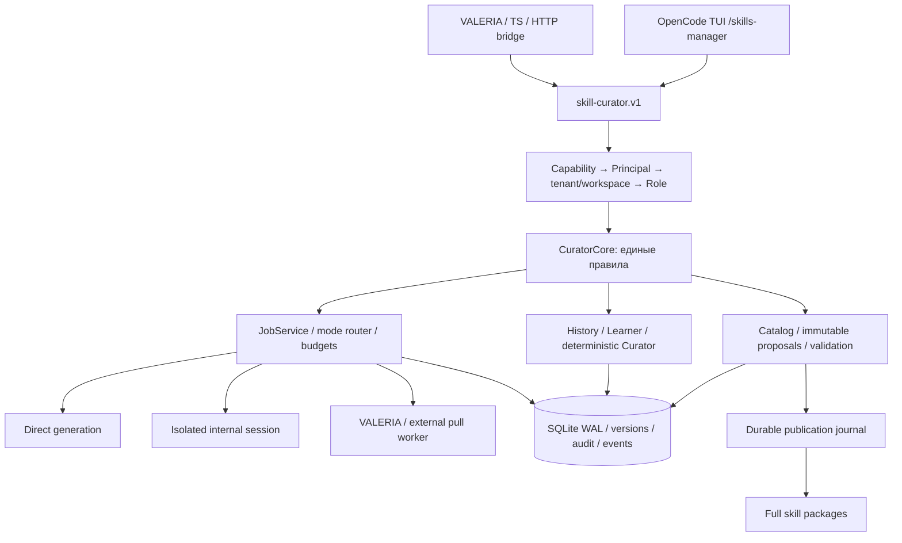
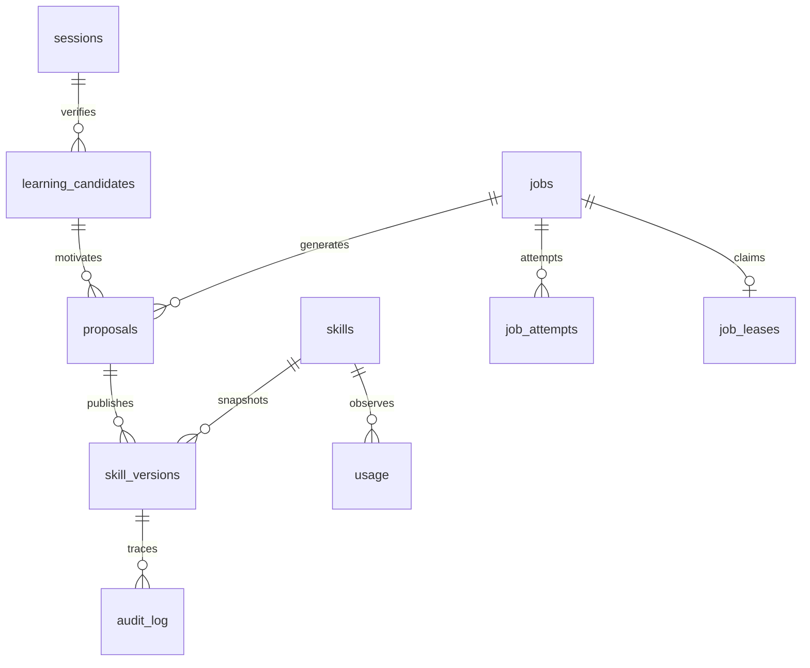

# Архитектура и модель данных

## Модули

| Файл                       | Ответственность                                                                             |
| -------------------------- | ------------------------------------------------------------------------------------------- |
| `server.ts`                | Реальная регистрация Plugin.define, RPC, skill transform/reload, capture и scheduler        |
| `core.ts`                  | Авторизованный dispatch 74 методов, идемпотентность, материализация LLM-контекста           |
| `catalog.ts`               | Каталог, revisions, версии, proposals, merge/split, публикация и recovery                   |
| `packages.ts`              | Allowlist путей, links, YAML, binary encoding, staged filesystem replacement                |
| `store.ts` / `database.ts` | SQLite, миграция v1, Node/Bun drivers, IMMEDIATE transactions, process lock, durable events |
| `jobs.ts`                  | Зафиксированный executor, конкурентность, бюджет, timeout, lease и reconciliation           |
| `learning.ts`              | Provenance, очистка, dedupe, evidence validation, deterministic findings                    |
| `settings.ts`              | Строгая схема настроек, deep patch, optimistic locking                                      |
| `rpc.ts`                   | Публичные Standard Schema/Zod-контракты и типы клиента                                      |
| `tui.tsx`                  | Solid/OpenTUI route и диалоги поверх RPC                                                    |

## Хранение

`<data_directory>/curator.sqlite` открывается с WAL, synchronous=FULL, busy_timeout=5000. По умолчанию каталог данных — `<project>/.curator`. Каталог навыков можно задать отдельно. БД содержит таблицы `skills`, `skill_versions`, `sessions`, `learning_candidates`, `proposals`, `jobs`, `job_attempts`, `job_leases`, `events`, `audit_log`, `settings`, `usage`, `idempotency`, `publications`, `control`. Строки — JSON с ограничением json_valid и стабильным primary key. Версия схемы хранится в `schema_migrations`; первая миграция транзакционная и повторяемая.

Пакеты располагаются под хешем **только** tenant/workspace и стабильным skill_id. Название навыка не является путём. Текст хранится в UTF-8, произвольные бинарные данные — строками `base64:<данные>`. Такой же формат применён в RPC export/import. Хеш вычисляется по канонически отсортированным ключам полного пакета. Просмотр файла не исполняет его.

Схема связей:

## Публикация и восстановление

1. Проверить policy, текущую revision, content integrity и фактический hash пакета на диске.
2. Сохранить durable journal: прежние и новые полные снимки, committed=false.
3. Создать staging-пакет, fsync файлов; заменить каталог через rename с backup. Обработать каждый пакет составной операции.
4. Одной SQLite-транзакцией сохранить новые skills, версии, статус proposal и события; отметить journal committed=true.
5. Удалить journal и обновить registry OpenCode. При ошибке reload каталог остаётся валидным, health показывает pending; повторный reload устраняет временную невидимость.

До открытия API recovery применяет старые снимки незавершённого journal либо новые снимки committed journal. При ошибке доступа/целостности запуск блокируется. Тесты прерывают настоящий дочерний процесс до и после фиксации БД. Физическое отключение питания и особенности сетевых FS отдельно не моделировались; хранение рекомендуется на локальном диске.

Второй writer в ту же БД запрещён process lock. После аварии lock снимается только при подтверждённом отсутствии прежнего PID. Мутации внутри процесса сериализованы; SQLite IMMEDIATE атомарно фиксирует leases и revisions.

## Jobs

Режим выбирается до постановки в очередь. `auto` выбирает первый доступный из предпочтений; активный job не мигрирует при изменении настроек. Локальные jobs исполняются scheduler, внешние — через atomic pull lease. В БД сохраняется SHA-256 случайного lease token. После истечения lease: `unknown_outcome`, запрет повторной выдачи/retry и консервативное сохранение бюджетного резерва. Прежний worker может прислать подтверждённый исход с прежней capability; повторный complete того же payload идемпотентен.

Лимит расходов проверяется по tenant за UTC-день, конкурентность — глобально, по executor и workspace. Незавершённые исходы удерживают слоты и резервы. Отмена принятого задания требует acknowledgement, потому что разрыв соединения сам по себе не доказывает остановку внешней модели.

## История

Lifecycle listener пишет только durable backlog marker, чтение контекста выполняется scheduler. Внутренние session IDs регистрируются до create/prompt. Сам факт `execution.succeeded` не доказывает успешное бизнес-решение: такой архив остаётся unverified. Импорт с проверенной provenance и подтверждённое инструментальное evidence позволяют Learner создавать кандидатов. Каждый кандидат проверяется на реальные source_refs и буквальное присутствие evidence. LLM-ответ не может одобрить собственное предложение.

Официальные источники совместимости: [server API](https://opencode.ai/docs/build/plugins/server/), [TUI API](https://opencode.ai/docs/build/plugins/cli/), [RPC API](https://opencode.ai/docs/build/plugins/rpc/), [package parts](https://opencode.ai/docs/build/plugins/). Проверены 14 ноября 2026; пакет закреплён на 2.3.0.
