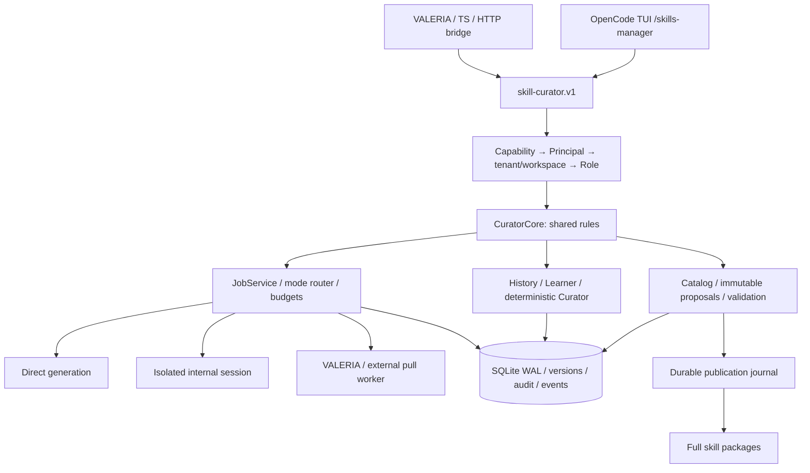
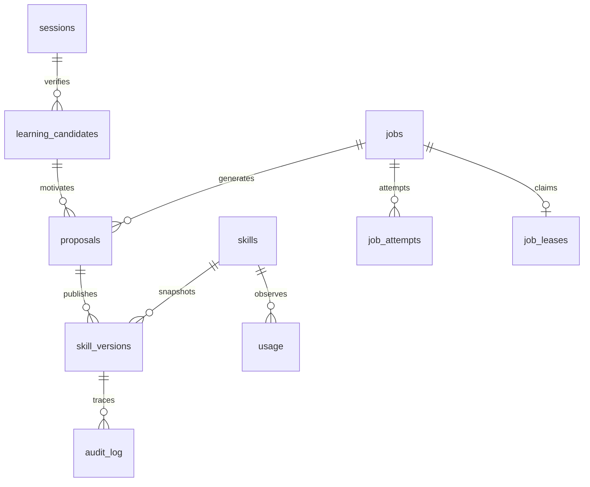

# Architecture and data model

## Modules

| File                        | Responsibility                                                                                   |
| --------------------------- | ------------------------------------------------------------------------------------------------ |
| `server.ts`                 | SDK `Plugin.define` registration, RPC, skill transformation/reload, capture, and scheduling      |
| `core.ts`                   | Authorized dispatch for 80 methods, idempotency, and LLM context materialization                 |
| `catalog.ts`                | Catalog, revisions, versions, proposals, merge/split, publication, and recovery                  |
| `packages.ts`               | Path allowlists, links, YAML, binary encoding, and staged filesystem replacement                 |
| `store.ts` / `database.ts`  | SQLite, v1 migration, Node/Bun drivers, IMMEDIATE transactions, process lock, and durable events |
| `jobs.ts`                   | Fixed executor selection, concurrency, budgets, timeouts, leases, and reconciliation             |
| `learning.ts`               | Provenance, redaction, deduplication, evidence validation, and deterministic findings            |
| `refine.ts`                 | Immutable conversation snapshots, catalog context, and create/update candidates                  |
| `conversation-review.ts`    | Durable action counts, response completion, deduplication, and automatic review delays           |
| `opencode-conversations.ts` | SDK history access with project, idle state, and capture race checks                             |
| `optimizer.ts`              | Bounded semantic plans, proposal validation, reports, and rollback snapshots                     |
| `curator-scheduler.ts`      | Durable curator scheduling, activity/idle checks, and retry state                                |
| `settings.ts`               | Strict settings schema, deep patches, and optimistic locking                                     |
| `rpc.ts`                    | Public Standard Schema/Zod contracts and client types                                            |
| `tui.tsx`                   | Solid/OpenTUI route and dialogs backed by RPC                                                    |

## Storage

`<data_directory>/curator.sqlite` uses WAL, `synchronous=FULL`, and `busy_timeout=5000`. The default data directory is `<project>/.curator`. The skill directory can be configured separately. The database contains `skills`, `skill_versions`, `sessions`, `learning_candidates`, `proposals`, `jobs`, `job_attempts`, `job_leases`, `events`, `audit_log`, `settings`, `usage`, `idempotency`, `publications`, and `control`. Rows contain JSON with a `json_valid` constraint and a stable primary key. `schema_migrations` records the schema version; the first migration is transactional and repeatable.

Package paths depend **only** on the tenant/workspace hash and stable `skill_id`. A skill name is not a filesystem path. Text uses UTF-8; arbitrary binary content uses `base64:<data>` strings. RPC export/import uses the same representation. Package hashes cover the complete package with canonically sorted keys. Viewing a file does not execute it.

Relationships:

## Publication and recovery

1. Check policy, current revision, content integrity, and the actual package hash on disk.
2. Save a durable journal containing complete old and new snapshots with `committed=false`.
3. Stage the package, fsync its files, and replace the directory through rename with a backup. Process every package in a compound operation.
4. Save new skills, versions, proposal status, and events in one SQLite transaction; set `committed=true` in the journal.
5. Remove the journal and reload the OpenCode registry. If reload fails, the catalog remains valid and health reports a pending reload; retrying reload restores visibility.

Recovery runs before the API opens. It restores old snapshots for an uncommitted journal or new snapshots for a committed journal. Access or integrity failures block startup. Tests terminate a real child process before and after the database commit. Physical power loss and network filesystem behavior were not separately modeled; local disk storage is recommended.

A process lock prevents a second writer from opening the same database. After a crash, the lock is removed only when the previous PID is confirmed absent. In-process mutations are serialized; SQLite IMMEDIATE transactions commit leases and revisions atomically.

## Jobs

The execution mode is selected before a job enters the queue. `auto` selects the first available preferred executor; an accepted job does not migrate when settings change. The scheduler runs local jobs; external jobs use atomic pull leases. The database stores the SHA-256 hash of a random lease token. Lease expiry produces `unknown_outcome`, blocks reassignment/retry, and conservatively retains the budget reservation. The previous worker can report a confirmed outcome with its original capability; repeating `complete` with the same payload is idempotent.

Spending limits apply per tenant per UTC day; concurrency limits apply globally, per executor, and per workspace. Unresolved outcomes retain slots and reservations. Canceling an accepted job requires acknowledgment because a disconnected connection does not prove that the external model stopped.

## History

In conversation review mode, a hook counts all completed tool calls separately for each conversation. A listener records a successfully completed response; started, failed, or interrupted responses clear that boundary. Before enqueueing a job, the scheduler checks the action threshold, delays, quiet hours, pause state, and native idle status. `control` stores the counter and a bounded deduplication window of the last 512 events. Retries with an unknown outcome retain their key; a confirmed rejection before acceptance allows a new attempt after a delay. History from before installation is not scanned automatically.

`learning.refine` reads the available SDK context, redacts it, limits its size, and records an immutable snapshot ID plus revisions and hashes of eligible targets. The text remains in `sessions` with `verified:false`; the job stores identifiers. The model receives the snapshot and catalog and returns candidates with either a new skill name or an existing `target_skill_id`. Updates append a Refinement section containing the procedure, conditions, failures, and quotes; other package files are preserved. Result acceptance checks quotes and allowed targets again. `truncated` and `catalog_omitted` identify incomplete context. A catalog conflict stops processing.

The separate `learning.run` path retains its original requirements: verified sources and literal evidence only. When conversation review is disabled, the original test-tool fragment capture and history backlog remain available. Internal session IDs are registered before create/prompt. No LLM response can approve its own proposal; only configured server policy can grant automatic approval.

Official compatibility references: [server API](https://opencode.ai/docs/build/plugins/server/), [TUI API](https://opencode.ai/docs/build/plugins/cli/), [RPC API](https://opencode.ai/docs/build/plugins/rpc/), and [package parts](https://opencode.ai/docs/build/plugins/). Checked on November 14, 2026; the package pins SDK 2.3.0.

## Semantic curator

`optimizer.ts` prepares bounded groups of complete packages, validates the model's plan, and stores proposals, reports, and rollback snapshots. `curator-scheduler.ts` persists the schedule and activity in `control`; it checks native idle status, pauses, unfinished jobs, and retries. Core authorizes optimize/status/rollback and accepts batches transactionally; JobService runs `operation=optimize` through the existing executors. Automatic merging requires the separate `allow_auto_merge` flag. See [CURATOR.md](CURATOR.md).
